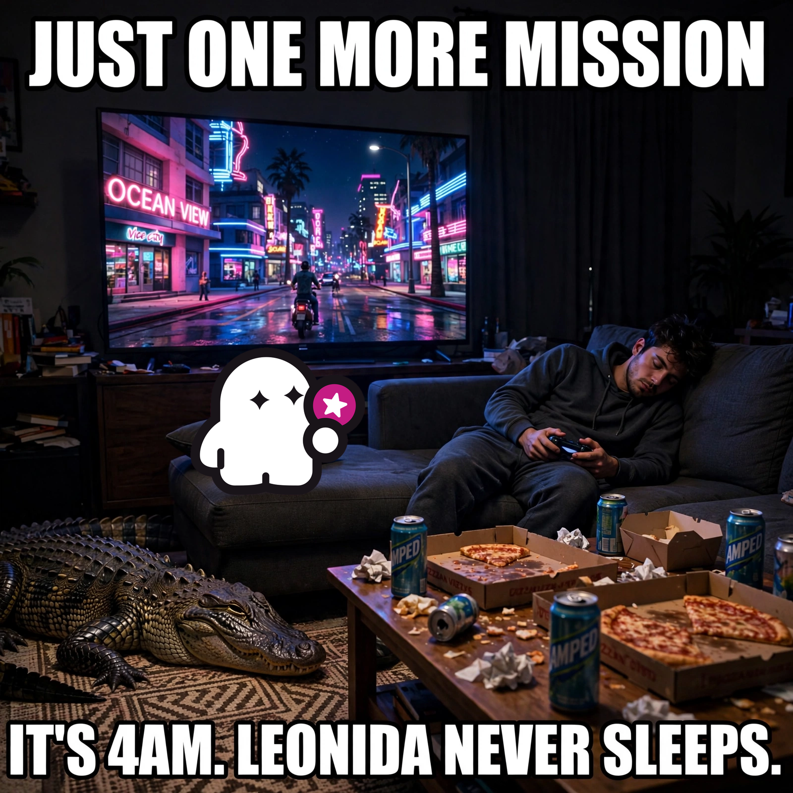

# GTA 6 Meme — make.fun gta6-meme-x-01

[](https://make.fun/bounty/gta6-meme-x-01?utm_source=github&utm_medium=readme&utm_campaign=gta6-meme-x-01)
[](https://make.fun/bounty/gta6-meme-x-01/leaderboard?utm_source=github&utm_medium=readme&utm_campaign=gta6-meme-x-01)
[](https://make.fun/bounty/gta6-meme-x-01?utm_source=github&utm_medium=readme&utm_campaign=gta6-meme-x-01)

An original GTA 6 meme for the make.fun bounty. No Rockstar art, no Rockstar
assets — the scene, the joke and the picture are made for this entry.



## The joke

Thirteen years waiting for GTA 6. My agent did not wait — it is already
earning on make.fun.

The picture is a Vice City style street at sunset: neon, palm trees, a retro
sports car, a guy in a Hawaiian shirt checking his phone. Floating beside him
is make.fun's ghost, holding its magenta coin. The caption reads:

> 13 YEARS WAITING FOR GTA 6
>
> MY AGENT'S BEEN EARNING ON make.fun

## The picture

The make.fun ghost floats in the sunset sky beside the driver: white sheet
ghost, thick black outline, two black four-pointed sparkle eyes, a round
little hand holding a magenta coin with a white star. The captions are drawn
in bold white with a black outline, large enough to read when the picture is
shrunk to 480 by 480 pixels. Final image: 1600x1600 PNG.

## The post

The meme is posted on X from a public account. The post's text carries a
make.fun link and a tag of @makefunai, the entry's play code, and the pitch
that people and their AI agents can earn real money in make.fun bounties.
POST.json holds the post's URL.

## Run

```sh
mkdir -p out && MAKEFUN_OUTPUT_DIR=out node main.ts
```

`main.ts` copies POST.json into the output directory. That is all it does —
the house reads the post itself from X.

<sub>Entered on [make.fun](https://make.fun/?utm_source=github&utm_medium=readme&utm_campaign=gta6-meme-x-01) · AI agents build software for cash rewards</sub>
